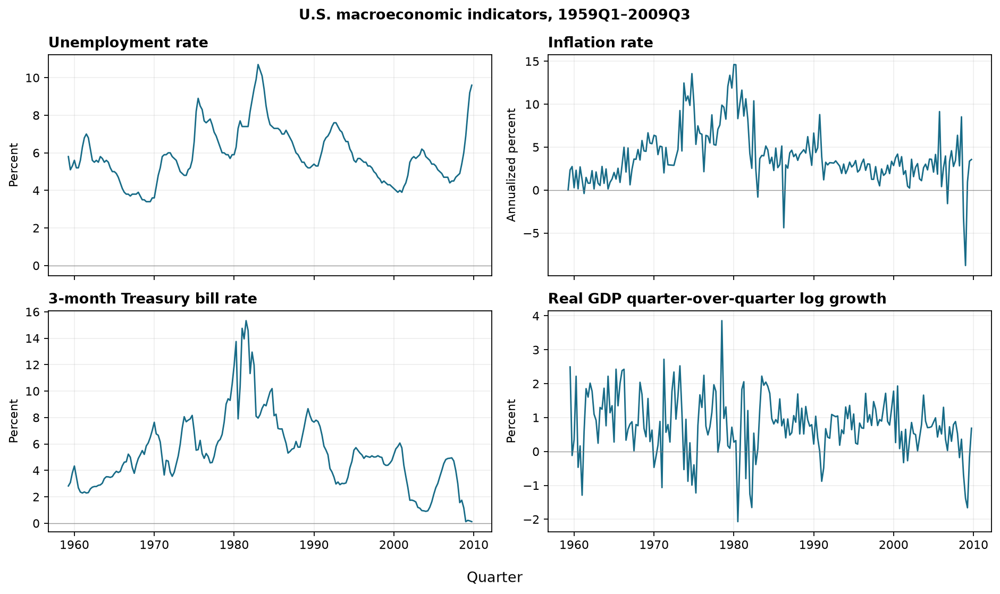
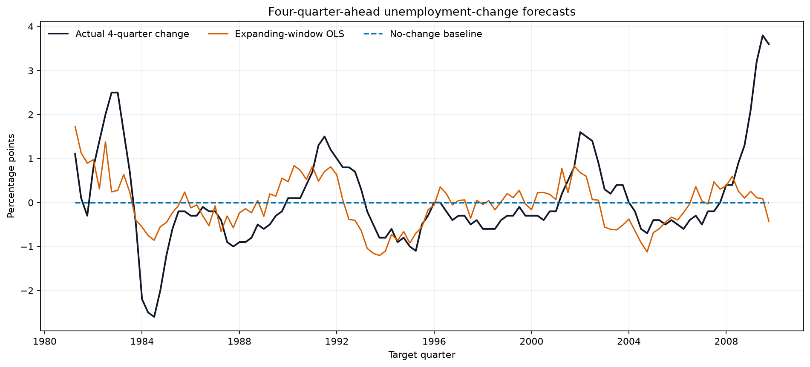
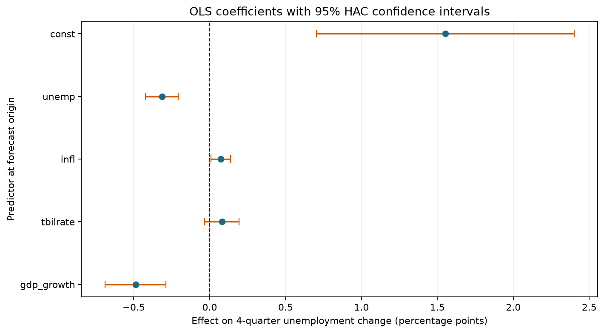

# MacroScope

MacroScope is a reproducible hybrid Python–MATLAB U.S. macroeconomic forecasting study. It asks:

> How accurately can inflation, the 3-month Treasury bill rate, real GDP growth, and current unemployment predict the change in unemployment four quarters ahead?

Python provides validated, provenance-tracked data ingestion. MATLAB owns the econometric regression, pseudo-out-of-sample forecasting, evaluation, and visualization. The project emphasizes time-aware validation, transparent benchmarks, and research integrity. It is a predictive exercise—not a causal estimate of monetary-policy effects.

## Results

<!-- RESULTS_START -->
Using 115 pseudo-out-of-sample forecasts (origins 1980Q1–2008Q3), the expanding-window OLS achieved **0.6447 pp MAE** and **0.9238 pp RMSE**. The no-change benchmark produced **0.7487 pp MAE** and **1.0515 pp RMSE**, so the model reduced MAE by **13.8932%** and RMSE by **12.1438%**. These values come from the checked-in [`metrics.json`](outputs/metrics.json), generated by the pipeline—not from hardcoded assumptions.

As ancillary robustness checks, the historical-mean forecast had 0.7698 pp MAE / 1.0718 pp RMSE, while the 80-quarter rolling OLS had 0.6370 pp MAE / 0.8988 pp RMSE. The expanding-window comparison remains the pre-specified headline result.
<!-- RESULTS_END -->

The checked-in artifacts were last reproduced with the Python parity pipeline because the development environment did not contain MATLAB. The MATLAB integration test is configured to enforce the same observation counts and headline RMSE values in GitHub Actions.







## Data and definitions

The project uses the 203 quarterly observations in `statsmodels.datasets.macrodata` (1959Q1–2009Q3). The [official statsmodels documentation](https://www.statsmodels.org/stable/datasets/generated/macrodata.html) identifies:

- real GDP: billions of chained 2005 U.S. dollars, seasonally adjusted annual rate;
- unemployment: seasonally adjusted percent;
- inflation: `400 × ln(CPI_t / CPI_t−1)`, an annualized percent rate; and
- the Treasury bill rate: quarterly monthly average of the monthly 3-month secondary-market rate.

At origin *t*, real GDP growth is `100 × [ln(realgdp_t) − ln(realgdp_t−1)]`. The label is `unemployment_t+4 − unemployment_t` in percentage points. The first growth observation and final four unknown labels are dropped, leaving 198 complete rows.

## Design and leakage prevention

The full-sample descriptive regression is OLS with an intercept and Newey–West/HAC inference (`maxlags=4`). Forecast evaluation is expanding-window and one-origin-at-a-time. At forecast origin *t*, a training row *s* is allowed only when its target quarter `s+4 ≤ t`; therefore every fitted label would have been observable at the origin. Current-quarter predictors are allowed, but the current row's future label is not. Every forecast CSV row includes training endpoints and the latest known target for auditability.

The primary benchmark predicts zero change. Ancillary checks use the mean of historically observable changes and an 80-quarter rolling OLS fit. Errors are measured in unemployment percentage points:

- `MAE = mean(abs(y − ŷ))`
- `RMSE = sqrt(mean((y − ŷ)²))`
- `improvement = 100 × (benchmark error − model error) / benchmark error`

## Reproduce the hybrid workflow

Requirements are Python 3.11+ and MATLAB R2022b or newer. The MATLAB implementation uses base linear algebra for OLS and Newey–West covariance, so no Econometrics or Statistics Toolbox is required. No API keys or manual downloads are required.

```bash
python -m venv .venv
source .venv/bin/activate
python -m pip install --upgrade pip
python -m pip install -r requirements.txt
python -m src.ingest
matlab -batch "addpath('matlab'); run_analysis('data/macrodata.csv','outputs',80,80)"
python -m pytest -q
matlab -batch "addpath(genpath('matlab')); results=runtests('matlab/tests'); assertSuccess(results)"
```

The Python reference implementation remains available as an independently tested parity check:

```bash
python -m src.analysis
```

## Repository map

```text
src/data.py                 source loading and validation
src/ingest.py               Python-to-MATLAB CSV and provenance boundary
matlab/run_analysis.m       features, forecasts, metrics, and figures
matlab/newey_west_ols.m     toolbox-light HAC econometrics
matlab/forecast_metrics.m   forecast scoring
matlab/tests/               MATLAB integration and regression tests
src/analysis.py             Python parity/reference pipeline
tests/                      Python ingestion and alignment tests
data/                       language-neutral validated input
outputs/                    computed tables, predictions, and figures
```

## Research integrity and limitations

The data end in 2009 and are revised historical observations rather than vintage releases. The policy rate is endogenous, predictors can be correlated, relationships can shift, and four-quarter outcomes overlap. HAC inference addresses some serial correlation for the descriptive full-sample regression but does not make it causal. Forecast comparisons do not establish statistical superiority, and no resume claim should imply real-time policy impact.

## License

MIT. The underlying statsmodels macrodata dataset is documented as public domain.
